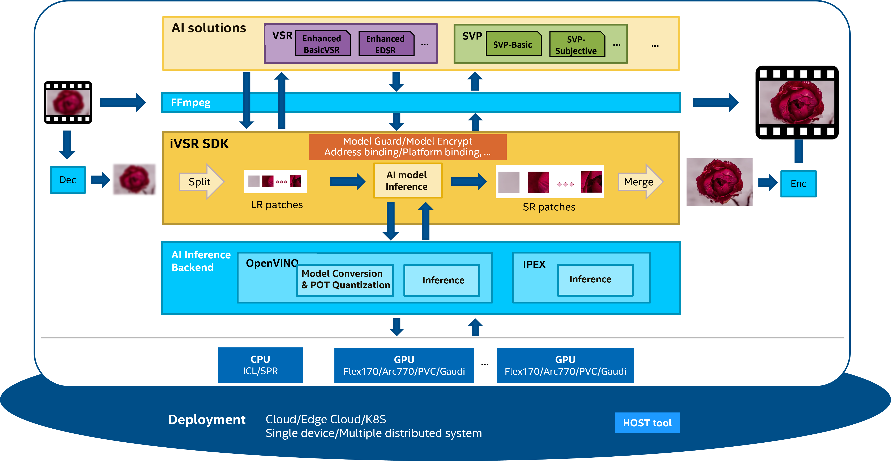

# What is iVSR

iVSR aims to facilitate AI media processing with exceptional quality and performance on Intel's hardware.

iVSR offers a patch-based, heterogeneous, multi-GPU, and multi-algorithm solution, 
harnessing the full capabilities of Intel's CPUs and GPUs. 
And iVSR is adaptable for deployment on a single device, a distributed system, cloud infrastructure, edge cloud, or K8S environment.

<!--  -->

# Why is iVSR needed

- Simple APIs are provided and the change of OpenVINO API will not be exposed.
- Patch-based solution is provided to enable the inference on HW with limited memory. For example, the SR of super-large-resolution input video, such as 4K.
- Features are provided to protect Intel created AI models which have Intel IP.
- All kinds of AI media processing algorithms can be accommodated under iVSR SDK.
- Performance optimization can be implemented for a specific algorithm to better meet customers’ needs.

# What can iVSR do
Now iVSR has two AI media processing functionalities: video super resolution (VSR) and smart video processing (SVP) for bandwidth optimization.
Inference can be run on both Intel CPU and Intel GPUs (including Flex170, Arc770) with OpenVINO and FFmpeg.

## Video Super Resolution (VSR)

Video super resolution (VSR) is widely used in AI media enhancement domain to 
convert low-resolution video to high-resolution.
iVSR provides two SR algorithms: Enhanced BasicVSR and Enhanced EDSR.

#### `Enhanced BasicVSR`
BasicVSR is a public AI-based VSR algorithm. 
For the details of public BasicVSR, please check the [paper](https://arxiv.org/pdf/2012.02181.pdf). 

We have enhanced the public model to achieve better visual quality and less computational complexity. 
The performance of BasicVSR inference has also been optimized for Intel GPU.

#### `Enhanced EDSR`
EDSR is another public AI-based single image SR algorithm.
For the details of public EDSR, please check the [paper](https://arxiv.org/pdf/1707.02921.pdf)

We have enhanced the public EDSR model to reduce the computational complexity by over 79% compared to Enhanced BasicVSR, while achieving similar visual quality.

## Smart Video Processing (SVP)
`SVP` is an AI-based video prefilter that enhances the perceptual rate-distortion in video encoding. 
With SVP, the encoded video streams achieve reduced bandwidth while maintaining the same visual quality, 
as measured by common video quality metrics (such as VMAF and (MS-)SSIM) and human perception.

# How to use iVSR

There three ways to run the above AI media processing.
Please expect `pre-production` quality of current solution.

### 1. Run with iVSR SDK
Refer to the guide [here](ivsr_sdk/README.md).

### 2. Run with OpenVINO
Refer to the guide [here](ivsr_ov/README.md).

### 3. Run with FFmpeg
Refer to the guide [here](ivsr_ffmpeg_plugin/README.md).

Please [contact us](mailto:beryl.xu@intel.com) to get the models.

## License

Please check the license under each folder.

