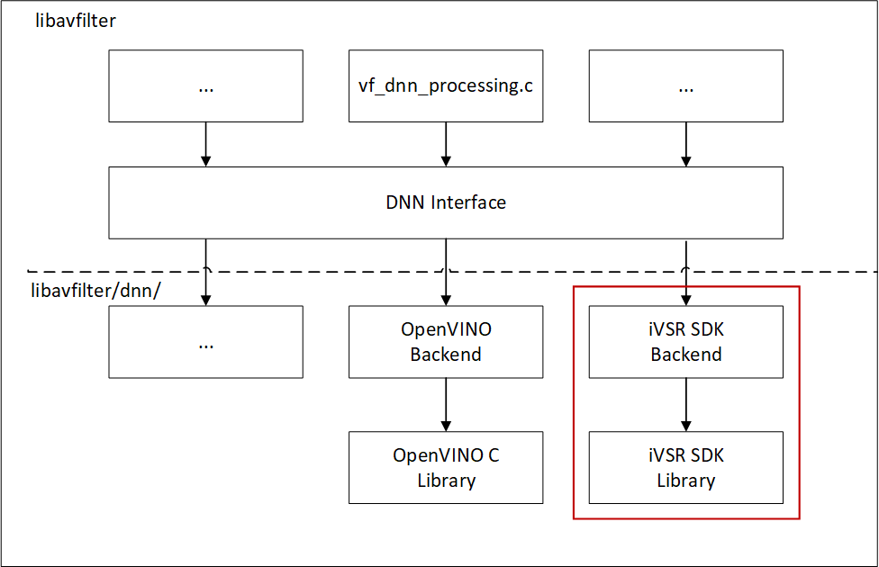

# iVSR FFmpeg plugin - iVSR SDK based
The folder `ivsr_ffmpeg_plugin/based_on_ivsr_sdk_backend` enables BasicVSR inference using FFmpeg with iVSR SDK as backend. 
The inference is validated with OpenVINO 2023.1 and FFmpeg 5.1. We've implemented some patches on the OpenVINO and FFmpeg to enable the pipeline. The folder patches includes our patches for FFmpeg.

<div align=center>

</div>

## Prerequisites
- Intel Xeon hardware platform
- Intel Data Center GPU Flex 170(*aka* ATS-M1 150W)
- Host OS: Linux based OS (Ubuntu 22.04)
- Docker OS: Ubuntu 22.04
- kernel: 5.17.0-1031-oem (Optional to enable Intel® Data Center GPU Flex Series accelerator)
- cmake
- make
- git
- docker 

## Build Docker Image
1. Set git config
Please set your git config user.name&email before installation, or our patches will not be applied automatically.

```
git config user.name [your name]
git config user.email [your email]
```

2. Set date&time correctly before building docker image, the following command takes Shanghai as an example.

  ```bash
  timedatectl set-timezone Asia/Shanghai
  ```

3. Set up docker service

```bash
sudo mkdir -p /etc/systemd/system/docker.service.d
printf "[Service]\nEnvironment=\"HTTPS_PROXY=$https_proxy\" \"NO_PROXY=$no_proxy\"\n" | sudo tee  /etc/systemd/system/docker.service.d/proxy.conf
sudo systemctl daemon-reload
sudo systemctl restart docker 
```

4. Build docker image

```bash
cd ivsr_ffmpeg_plugin/based_on_ivsr_sdk_backend
./build_docker.sh
```

If building successfully, you can see a docker image named `ffmpeg_ivsr_sdk` .

## Start Docker Container

```bash
sudo docker run -itd --name ffmpeg_ivsr_sdk --privileged -e MALLOC_CONF="oversize_threshold:1,background_thread:true,metadata_thp:auto,dirty_decay_ms:9000000000,muzzy_decay_ms:9000000000" -e http_proxy=$http_proxy -e https_proxy=$https_proxy -e no_proxy=$no_proxy --shm-size=128g --device=/dev/snd:/dev/snd ffmpeg_ivsr_sdk:latest bash
sudo docker exec -it ffmpeg_ivsr_sdk bash
source /workspace/ivsr/ivsr_gpu_opt/based_on_openvino_2022.3/openvino/install/setupvars.sh
ldconfig
```
## How to run inference with FFmpeg-plugin
- Use FFmpeg-plugin to run BasicVSR inference
```
cd /workspace/ivsr/ivsr_ffmpeg_plugin/based_on_ivsr_sdk_backend/ffmpeg
./ffmpeg -i <your test video> -vf format=bgr24,dnn_processing=dnn_backend=ivsr:model=<basic_vsr_model.xml>:input=input:output=output:nif=3:backend_configs='nireq=1&device=CPU' test_out.mp4
```
- Use FFmpeg-plugin to run SVP inference (input must be 1920x1088)
```
cd /workspace/ivsr/ivsr_ffmpeg_plugin/based_on_ivsr_sdk_backend/ffmpeg
./ffmpeg -i <your test video> -vf format=bgr24,dnn_processing=dnn_backend=ivsr:model=<svp_model.xml>:input=input:output=output:nif=1:backend_configs='nireq=1&device=CPU&model_type=1' test_out.mp4
```
- Use FFmpeg-plugin to run EDSR inference
```
cd /workspace/ivsr/ivsr_ffmpeg_plugin/based_on_ivsr_sdk_backend/ffmpeg
./ffmpeg -i <your test video> -vf format=bgr24,dnn_processing=dnn_backend=ivsr:model=<edsr_model.xml>:input=input:output=output:nif=1:backend_configs='nireq=1&device=GPU&model_type=2&normalize_factor=255.0' test_out.mp4
```

- Work modes of FFmpeg-plugin

Decoder and encoder work similar to FFmpeg 5.1. Options and command line formats are not changed.
Only the options of video filter `dnn_processing` are introduced.

|AVOption name|Description|Default value|Recommended value(s)|
|:--|:--|:--|:--|
|dnn_backend|DNN backend framework name|native|ivsr|
|input_width|input video width|1920|1920|
|input_height|input video height|1080|1080|
|model|path to model file|NULL|Available full path of the released model files|
|input|input name of the model|NULL|input|
|output|output name of the model|NULL|output|
|backend_configs:nireq|number of inference request|2|1 or 2 or 4|
|backend_configs:device|device for inference task|CPU|CPU or GPU|
|backend_configs:model_type|type for models|0|0 for BasicVSR, 1 for SVP, 2 for EDSR|
|backend_configs:normalize_factor|factor for normalization|1.0|1.0 for BasicVSR and SVP, 255.0 for EDSR|

Apart from the common AVOptions which can be set in the normal FFmpeg command line with format `AVOption=value`, there are two options `nireq` and `device` to be set with the `backend_configs` option. The command format is `backend_configs='nireq=value&device=value'` when you want to set both of them.

- Inference model precision and custom operation supportive 

OpenVINO models with different precisions can be supported by the FFmpeg-plugin. In this release, we have validated FP32 and INT8 models which are converted and quantized by the model optimizer of OpenVINO 2022.3.

The [Custom OpenVINO™ Operations](https://docs.openvino.ai/latest/openvino_docs_Extensibility_UG_add_openvino_ops.html) is a great feature of OpenVINO which allows users to support models with operations that OpenVINO does not support out-of-the-box. 
This FFmpeg-plugin supports BasicVSR which utilizes custom operations. There is no additional options required for the command line in the case you have set the right path of the model. Please be noted that the dependent files are located in the docker container folder `/workspace/ivsr/ivsr_gpu_opt/based_on_openvino_2022.3/openvino/flow_warp_custom_op` and `/workspace/ivsr/ivsr_gpu_opt/based_on_openvino_2022.3/openvino/bin/intel64/Release/lib`, do not make any changes to them.
