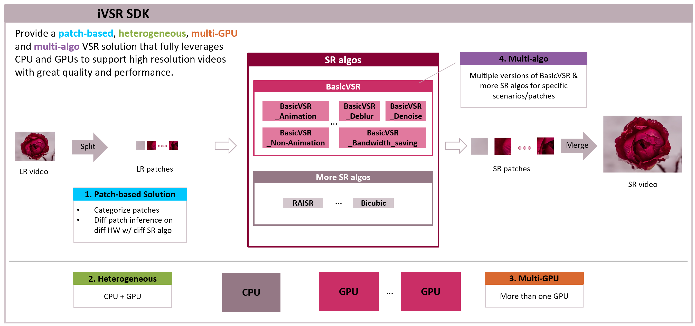

# Intel Video Super Resolution Development Kit


Intel Video Super Resolution Development Kit (iVSR SDK) is a SDK which incorporate state-of-the-art deep learning based super resolution technology which can reduce the flash b/w single frames of the video.

The SDK Core consists of two parts, one is the small patch solution part, the other is the task scheduler part. 
1. The patch solution part will split the large images into small ones, then the smaller patch is wrapped as one inference task and put it in the task queue in the scheduler module. By the way, each small patch will have a flag to indicate which kind of platform it will be used for inference.
1. The task scheduler module will fetch task from the task queue and send the task to the corresponding hardware according to the flag set by each small patch.

The VSR SDK sample application supports to deliver super resolution algorithms on multi-HW devices, target to deliver a high quality and performance VSR system.

<br />

## **Feature Overview**

<!--  -->
<div align=center>

</div>

<br />

## **API Introduction**


The iVSR toolkit only provides API for C. All available interfaces are listed in the following table for [overview](#overview). Please refer to [Detailed Description](#detailed-description) for more information .


### **Overview**

|Function name|Operation|
|:--|:--|
|[ivsr_init](#ivsr_init)|Initialize the software development kit.|
|[ivsr_process](#ivsr_process)|Inference one task, which would return a handle for application to query the inference result.|
|[ivsr_reconfig](#ivsr_reconfig)|Reset and re-config VSR configurations.|
|[ivsr_get_attr](#ivsr_get_attr)|Get VSR configuration status.|
|[ivsr_deinit](#ivsr_deinit)|De-initialize the resource allocated for the SDK.|


### **Detailed Description**


#### **ivsr_init**

Initialize the software development kit.

**Syntax**

```C 
IVSRStatus ivsr_init(ivsr_config_t *configs, ivsr_handle *handle); 
```
**Parameters**

- `configs`: Pointer to the configurations to initialize the intel VSR SDK.
- `handle`: handle allocated for VSR memory and status. 

**Description**

The function creates VSR handle and safety thread according to the configurations and prepares inference environment.

**Return Values**

 `IVSRStatus`	Return the VSR Status to indicate whether initialization is successful or not.


#### **ivsr_process**

Inference one task, which would return a handle for application to query the inference result.

**Syntax**

```C
IVSRStatus ivsr_process(ivsr_handle handle, char* input_data, char* output_data, ivsr_cb_t* cb); 
```

**Parameters**

- `handle`	handle allocated for VSR memory and status. 
- `input_data`  	Pointer to the input data
- `output_data`	Pointer to the output data
- `cb`	Call back functions to indicate the finish of VSR tasks

**Description**

The function does task inference for the input data and generats the output data.

**Return Values**

`IVSRStatus`	Return the VSR Status to indicate whether VSR process is successful.


#### **ivsr_reconfig**

Reset and re-config VSR configurations.

**Syntax**

```C
IVSRStatus ivsr_reconfig(ivsr_handle handle, ivsr_config_t* configs); 
```

**Parameters**

- `handle`	handle allocated for VSR memory and status
- `input_data`  	Pointer to VSR configurations

**Description**

 The function re-config VSR configurations.

**Return Values**

`IVSRStatus`	Return the VSR Status to indicate whether re-config is successful.


#### **ivsr_get_attr**

Get VSR configuration status.

**Syntax**

```C
IVSRStatus ivsr_get_attr(ivsr_handle handle, IVSRAttrKey key, void* value); 
```

**Parameters**

- `handle`	handle allocated for VSR memory and status. 
- `key`  	The key used to indicate which attribute is needed.
- `value`	Pointer to the attribute value got.

**Description**

The function is used to get the attribute value needed.

**Return Values**

`IVSRStatus`	Return the VSR Status to indicate whether VSR get attr is successful.


#### **ivsr_deinit**

De-initialize the resource allocated for the SDK.

**Syntax**

```C
IVSRStatus ivsr_deinit(ivsr_handle handle); 
```

**Parameters**

`handle`	handle allocated for VSR memory and status. 

**Description**

The function de-initialize the handle allocated for SDK.


**Return Values**

`IVSRStatus`	Return the VSR Status to indicate whether VSR deinit is successful.

<br />

##  **VSR Sample**


There is a simple C++ sample to perform BasicVSR inference on OpenVINO backend. You can reach the sample from `/workspace/ivsr/ivsr_sdk/bin/vsr_sample`. You can get the help messages by running `./vsr_sample -h`  and see the default settings of parameters.

|Option name|Desciption|Default value|Recommended value(s)|
|:--|:--|:--|:--|
|h|Print Help Message|||
|cldnn_config|Required. Path of CLDNN config.|None|< Path to OpenVINO >/flow_warp_custom_op/flow_warp.xml|
|data_path|Required. Input data path for inference.|None||
|device|Optional. Device to perform inference.|CPU|CPU or GPU or MULTI:GPU.0,GPU.1|
|extension|Optional. Extension (.so or .dll) path of custom operation.|None|< Path to basicvsr_sample>/lib/libcustom_extension.so|
|model_path|Required. Path of BasicVSR OpenVINO IR model (.xml).|None||
|nig|Optional. Number of input groups for inference.|1||
|save_path|Optional. Path to save predictions.|./outputs|If use the default value, make sure default path exists.|
|save_predictions|Optional. Whether to save the results to save_path.|false|If this option exists, results will be saved.|

Please note that all the pathes specified by options should exist and do not end up with '/'. Here are some examples to run BasicVSR inference on different devices:

```bash
# VSR sample on CPU
./vsr_sample --model_path=[your model.xml] --data_path=[folder contains low resolution images] --extension=/workspace/ivsr/ivsr_gpu_opt/based_on_openvino_2022.3/openvino/bin/intel64/Release/libcustom_extension.so --cldnn_config=/workspace/ivsr/ivsr_gpu_opt/based_on_openvino_2022.3/openvino/flow_warp_cl_kernel/flow_warp.xml --nig=3 --device=CPU          
# VSR sample on Single GPU
./vsr_sample --model_path=[your model.xml] --data_path=[folder contains low resolution images] --extension=/workspace/ivsr/ivsr_gpu_opt/based_on_openvino_2022.3/openvino/bin/intel64/Release/libcustom_extension.so --cldnn_config=/workspace/ivsr/ivsr_gpu_opt/based_on_openvino_2022.3/openvino/flow_warp_cl_kernel/flow_warp.xml --nig=3 --device=GPU
# VSR sample on Multiple-GPUs
./vsr_sample --model_path=[your model.xml] --data_path=[folder contains low resolution images] --extension=/workspace/ivsr/ivsr_gpu_opt/based_on_openvino_2022.3/openvino/bin/intel64/Release/libcustom_extension.so --cldnn_config=/workspace/ivsr/ivsr_gpu_opt/based_on_openvino_2022.3/openvino/flow_warp_cl_kernel/flow_warp.xml --nig=3 --device=MULTI:GPU.0,GPU.1
```

<br />

##  **Test Cases**


There are some unit tests for the iVSR API. You can reach the unit tests from "`/workspace/ivsr/ivsr_sdk/bin/vsr_unit_test`". Since model is essential for inference, you need to prepare models (*.bin and *.xml ) to the same path of `vsr_unit_test` and rename the model files to " test_with_custom_op.xml" and " test_with_custom_op.bin".

You can perform unit tests by runing the following command:

```bash
./vsr_unit_test
```

Then you can obtain the test results with status <font color="#00dd00">PASSED</font> or <font color="#dd0000">FAILED</font>.

<br />

## **Set Up**

A dockerfile is provided to set up the environment quickly and easily. You can refer to [Environment Set Up](./README.md) for details.